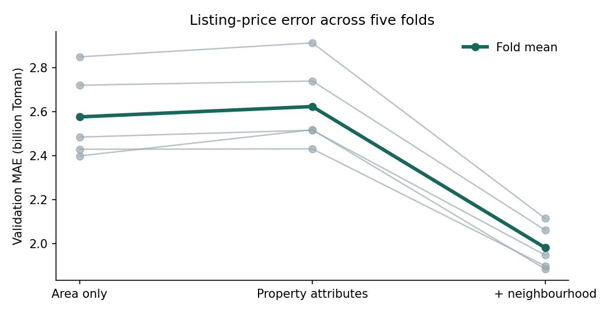

# Tehran housing prices | Hedonic regression

How much does neighbourhood improve a listing-price estimate once floor area, room count and amenities are known? This scikit-learn project compares three linear feature sets on the same Tehran listings, then compares regularisation and a log-scale price model.

## Results

Log-log Ridge (α = 0.1) had the lowest mean validation MAE, **1.449 billion Toman**. On the 645-listing test partition its MAE was **1.313 billion Toman**, RMSE was **2.893 billion Toman** and R² was **0.845**.

| Model | Mean CV MAE ↓ | Mean CV RMSE ↓ | Mean CV R² ↑ |
| --- | ---: | ---: | ---: |
| Area only · OLS | 2.577 | 5.035 | 0.536 |
| Property attributes · OLS | 2.624 | 5.017 | 0.540 |
| Attributes + neighbourhood · OLS | 1.982 | 4.258 | 0.666 |
| Full model · Ridge (α = 1) | 1.980 | 4.257 | 0.666 |
| Full model · Lasso (α = 0.001) | 1.981 | 4.258 | 0.666 |
| Full model · log-log Ridge (α = 0.1) | **1.449** | **3.826** | **0.736** |

MAE and RMSE are in billion Toman. Each row averages the same five validation folds. Adding neighbourhood to the property attributes lowered OLS MAE in every fold, by **24.4%** on average when comparing the two mean errors. The earlier price-scale Ridge model produced negative estimates for **82 of 645** test listings (12.7%). That finding motivated modelling log price as a function of log area and the remaining attributes. Exponentiating the fitted value gives a positive estimate in the original units.



For a 100 m², two-room listing with parking, storage and an elevator, the selected model predicts **4.51 billion Toman in Punak** and **6.69 billion in Gheitarieh**. The difference describes an association in this sample. Building age, condition and other unrecorded characteristics may also vary by neighbourhood.

## Quick start

From the repository root with Python 3.10+ in a virtual environment:

```bash
python -m pip install -e ".[dev]"
hedonic --output-dir reports
```

The first run fetches the source CSV at a pinned upstream revision and caches it in `data/raw/`. For an offline run, pass `--data-path` with a local copy. The command writes scores, split assignments, predictions and figures to `reports/`. Use `hedonic --no-plots` for a metrics-only run or `hedonic --help` for all options.

## Experimental protocol

- **Population.** The source contains 3,479 residential listings. Normalising input types and removing 208 duplicate rows, 23 incomplete records and 23 listings outside the fixed 30–500 m² range leaves **3,225**. All eligible positive prices are retained. The target is the listed price in billion Toman. The USD price column is excluded. [Source CSV at the recorded revision](https://github.com/SharifiZarchi/IntroAI/blob/f04daf55f28392bee7a0c125a6ee1d93cae30427/Session_04/TehranHouses/housePrice.csv)
- **Validation.** A shuffled 80/20 split with seed 42 reserves 645 listings. Five shuffled folds within the other 2,580 listings determine the model and regularisation strength by mean MAE. Both Ridge variants use α ∈ {0.1, 1, 10} and Lasso uses α ∈ {0.001, 0.01, 0.1}. The selected pipeline is fitted on all 2,580 training listings and scored on the reserved set.
- **Features.** The property model uses area, room count, parking, storage and elevator access. The full model adds neighbourhood. Within each training fold, the pipeline standardises the numeric inputs and one-hot encodes neighbourhood with a reference category. Neighbourhoods with fewer than ten training examples are pooled when present.
- **Scope.** The split measures performance on other rows from the same data source. The dataset provides neither completion prices nor listing dates or property identifiers. This experiment cannot establish future-market accuracy or rule out multiple listings for a property. The test partition had already been inspected when the log-scale model was proposed. Its test scores are a retrospective comparison on that partition. An independent assessment would require new listings.

## Reproducibility

```bash
python scripts/verify_results.py
python -m pytest
ruff check .
```

The audit runs offline with the Python standard library. It reconciles split IDs, reconstructs the test metrics and checks model selection against the saved fold scores. After the first training run, add `--data-path data/raw/housePrice.csv` to verify the source digest and each test target. To audit a fresh run, pass `--results reports`.

| File | Contents |
| --- | --- |
| [metrics.json](results/metrics.json) | Full-precision metrics, selected settings, package versions and matched examples |
| [cv_scores.csv](results/cv_scores.csv) | One row per candidate and validation fold |
| [split.csv](results/split.csv) | Zero-based source row, train/test partition and training validation-fold assignment |
| [test_predictions.csv](results/test_predictions.csv) | Source row, actual price and predicted price for each test listing |

The package lives in [src/hedonic](src/hedonic). The [tests](tests) cover cleaning, model selection, unseen neighbourhoods, the CLI and published results.
